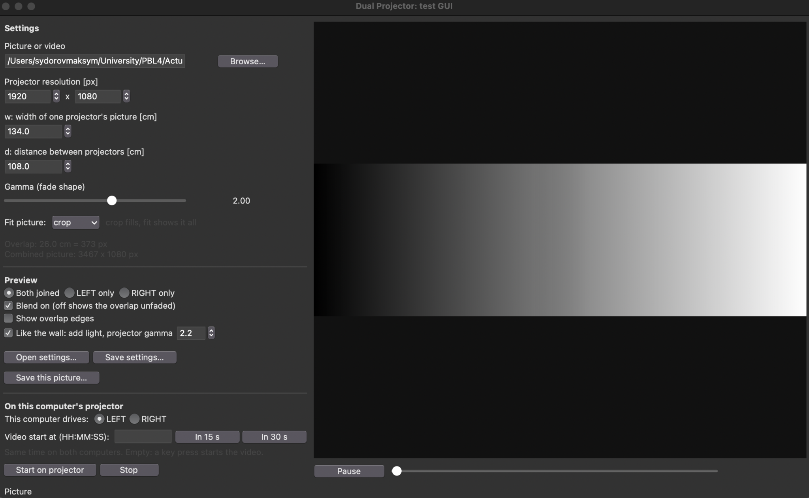

# Software setup and usage {#software_usage}

Install the project on both computers, one computer for each projector. Both installations should use the same project version, source file, and projection settings. The only setting that should differ is the projector side (`LEFT` or `RIGHT`).

The project requires **Python 3.14 or later**, NumPy, and OpenCV. The test suite uses `pytest`. The recommended installer is [uv](https://docs.astral.sh/uv/), which can download the Python version specified by the project and install the locked dependencies.

## 1. Install the software

Install `uv` first.

**macOS and Linux:**

```bash
curl -LsSf https://astral.sh/uv/install.sh | sh
```

**Windows (PowerShell):**

```powershell
powershell -ExecutionPolicy ByPass -c "irm https://astral.sh/uv/install.ps1 | iex"
```

Clone the repository and install its dependencies:

```bash
git clone https://github.com/maksym-syd/video_projector.git
cd video_projector
uv sync
```

`uv sync` creates a local `.venv` environment and installs the dependencies recorded in `uv.lock`. The project configuration specifies Python 3.14 or later.

### Alternative: install with pip

If you do not want to use `uv`, install Python 3.14 or later, create a virtual environment, activate it, and install the project requirements.

**macOS and Linux:**

```bash
python3.14 -m venv .venv
source .venv/bin/activate
pip install -r requirements.txt
```

**Windows (PowerShell):**

```powershell
py -3.14 -m venv .venv
.venv\Scripts\Activate.ps1
pip install -r requirements.txt
```

The commands below use `uv run`. If you installed with pip, activate `.venv` first and replace `uv run python` with `python`.

## 2. Configure the project

The program reads its configuration from a JSON file. The repository includes:

- `settings.json` — example configuration for a picture.
- `settings.video.json` — example configuration for a video.

Edit the settings on both computers so that the geometry, source path, blend setting, and scaling mode match. Set `projectorSide` to `LEFT` on the computer connected to the left projector and `RIGHT` on the other computer.

| JSON key | Purpose |
|---|---|
| `projectorResXY` | Projector's native resolution as `[width, height]` in pixels. |
| `imageWidthCm` | Width `w` covered by one projected image, in centimetres. |
| `projectorSpacingCm` | Distance `d` between the projected-image centres, in centimetres. |
| `blendCurveGamma` | Controls the shape of the brightness fade in the overlap. |
| `sourcePath` | Path to the picture or video to display. |
| `projectorSide` | `LEFT` or `RIGHT`, identifying this computer's projector. |
| `scaleMode` | Optional. `crop` fills the combined image and cuts off excess edges; `fit` shows the whole source with black bars. Defaults to `crop`. |

A relative `sourcePath` is resolved from the directory containing the settings file. Both computers must be able to read the source at the configured path.

Supported video extensions are `.mp4`, `.m4v`, `.mov`, `.avi`, `.mkv`, and `.webm`. Actual playback also depends on the codec being supported by the installed OpenCV build. Video playback has no audio.

The example video settings refer to `test_images/demo.mp4`, which is generated locally and is not included in the repository. From the repository root, create it with:

```bash
uv run python tools/make_test_video.py
```

## 3. Run the projection program {#run_program}

Run `main.py` on each computer, using the same settings file and the appropriate side:

```bash
uv run python main.py settings.json --side LEFT
uv run python main.py settings.json --side RIGHT
```

The `--side` option overrides `projectorSide` in the JSON file. The optional `--scale-mode crop` or `--scale-mode fit` option overrides `scaleMode`.

For a video, the first frame is displayed before playback starts. Press any key to start, then press `q` or `Esc` to stop. The video loops when it reaches the end.

### Synchronize video playback

To schedule both computers to start at the same time, pass the same local time to each process using `--start-at`:

```bash
uv run python main.py settings.video.json --side LEFT --start-at 14:30:05
uv run python main.py settings.video.json --side RIGHT --start-at 14:30:05
```

Accepted time formats are `HH:MM`, `HH:MM:SS`, `YYYY-MM-DD HH:MM`, and `YYYY-MM-DD HH:MM:SS`. Use local time and give both computers the same time and time zone.

Each computer chooses the frame corresponding to the clock time. A computer that starts late can join at the appropriate frame rather than beginning from the first frame. For this to work, keep both computer clocks synchronized, for example by enabling automatic time synchronization. Without `--start-at`, the computers begin after separate key presses, so a small timing difference is expected.

`--start-at` is ignored for a picture source.

## 4. Quick test with `instant_run.py`

`instant_run.py` is a launcher for the test video or picture. Run it from the repository root on both computers.

On the first computer, start the left projector and schedule the video to begin in 30 seconds:

```bash
uv run python instant_run.py --left --start-in 30
```

The command prints the start time and a command for the second computer. Run the printed command on the second computer from its repository folder. The second computer should use the opposite side. Both computers need synchronized clocks and the same time zone.

Useful options:

- `--left` or `--right` — run the real projection program for that side.
- `--video` — use `settings.video.json` (the default).
- `--image` — use `settings.json`; a picture does not use a start time.
- `--start-in SECONDS` — schedule a start a number of seconds in the future.
- `--start-at TIME` — use an explicitly specified shared local time.
- No side option — open a joined preview on the current computer.
- `--gui` — open the test GUI. It cannot be combined with a side or start-time option.

Examples:

```bash
uv run python instant_run.py --left
uv run python instant_run.py --right
uv run python instant_run.py --image
uv run python instant_run.py --gui
```

The default video start delay is five seconds when a side is selected and no start option is supplied.

## 5. Use the test GUI

The test GUI provides one place to edit the settings, inspect the joined output, and start the projection program. Run it on either computer:

```bash
uv run python gui.py [settings.json]
```

The settings file is optional. If supplied, the GUI loads it when it opens. The GUI can preview a picture or video without connecting the projectors; the preview is generated separately from the actual projector display.



### What the window shows

The left side contains the **Settings** and **Preview** controls. The right side shows the preview. When a setting changes, the preview is updated. If a value is invalid, an error message appears and the last valid preview is kept.

**Settings**

- **Picture or video**: selects the source file. Use **Browse…** to choose it.
- **Projector resolution [px]**, **w** (width of one projector's picture, in cm), and **d** (distance between the projectors, in cm): the same geometry values used in `settings.json`.
- **Gamma (fade shape)**: adjusts the shape of the brightness fade across the overlap. The best value depends on the real projectors; on the projectors tested for this system, 2.0 produced an even join, while 1.0 left a dark line in the middle.
- **Fit picture**: `crop` fills the combined image and cuts off excess edges; `fit` shows the whole source with black bars.
- **Open settings…** and **Save settings…**: load settings from a JSON file or save the current values to one.

**Preview**

- Choose **Both joined**, **LEFT only**, or **RIGHT only** to select which output is shown.
- **Blend on** applies the overlap fade. Turn it off to inspect the overlap without blending.
- **Show overlap edges** marks where the overlap starts and ends.
- **Like the wall** simulates projected light by applying the projector gamma (2.2 by default) to the pixel values before combining the projector outputs. This gives a more realistic preview of brightness; a dark or bright band in this mode may also be visible on the wall.
- For a video, use **Pause** and the seek bar to pause playback or move to another position. The video loops.
- **Save this picture…** saves the current preview as an image.

**Running on the projector**

- **This computer drives** selects `LEFT` or `RIGHT` for the projector connected to this computer.
- **Video start at (HH:MM:SS)** sets the shared start time for both computers. **In 15 s** and **In 30 s** fill in a start time a short time in the future. Leave the field empty to start after a key press.
- **Start on projector** launches `main.py` with the current settings for the selected side, in a separate window. **Stop** stops that projection process.

### A typical workflow

1. Open the GUI with the settings file you want to use.
2. Enter the measured projector resolution, `w`, and `d`. Check that the source file is correct.
3. Enable **Like the wall** and inspect the overlap. Adjust **Gamma (fade shape)** until the join looks even. A value of 2.0 worked on the projectors used during testing, but the correct value may differ with other projectors.
4. Save the settings. Copy the settings file to the second computer and set its projector side to the opposite side. Keep the source, geometry, and blend settings the same on both computers.
5. Set the same video start time on both computers, then press **Start on projector** on each. If the start-time field is empty, use a key press to start each process; the starts may not be perfectly synchronized.

The GUI is intended for configuration and preview as well as launching the real projection. You can also run `main.py` directly as described in @ref run_program "Run the projection program"

## 6. Check the connected displays

Before running the projection pipeline, confirm that the operating system detects each projector as a separate display. The `display.py` smoke test opens a test image on a selected display:

```bash
uv run python display.py
```

Press `q` or `Esc` to close the test. It also closes automatically after 30 seconds. The display rectangles are configured in the smoke-test section of `display.py`; each rectangle is `(x, y, width, height)` in logical pixels.

## 7. Run the tests

Install the development dependencies and run the test suite:

```bash
uv sync --group dev
uv run pytest
```

The tests check the geometry calculations, settings validation, image processing, video handling, display behaviour, and pipeline components.

@note Some modules are generated from a UML model. Keep the `# ˅` and `# ˄` markers and make changes only in the designated code sections; edits outside those markers may be overwritten when the code is generated.

Back to the @ref mainpage "main page".
